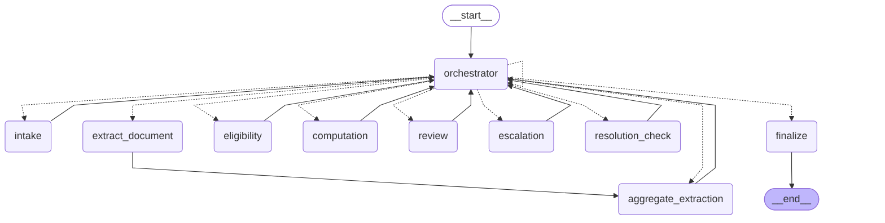

# SilverFile

A multi-agent preparation aid that turns a short conversation and a handful of uploaded tax documents into a **draft Form 1040-SR (tax year 2025) with a provenance record for every number**. Built for the Kushim proof of concept (Cornell ENMGT 5405). It prepares drafts for a human preparer; it never files, never advises, and stops for a person whenever the brief says it must.

> Software status: a proof of concept on synthetic data. The test SSNs are all in the 900 series and the W-2 images say "synthetic test document" on their face.

## Running it

```bash
python -m venv .venv && . .venv/bin/activate
pip install -r requirements.txt && pip install -e .
python data/generate_fixtures.py          # synthetic documents and W-2 images
cp .env.example .env                       # add ANTHROPIC_API_KEY to use Claude; blank = offline mode
python run.py serve                        # dashboard + taxpayer chat at http://localhost:8000
```

Other entry points:

| Command | What it does |
| --- | --- |
| `python run.py demo case1_clean` | Clean run in the terminal with a prefilled intake; writes `outputs/<id>.html` |
| `python run.py demo case2_hitl` | HITL run; pauses for the filing-status decision, resolve it on the command line or with `--resolve '{...}'` |
| `python run.py chat` | Hold the intake conversation yourself, one question at a time; `--resume <id>` continues a session |
| `python run.py batch [--no-context-strategy]` | The ten-document context-window measurement (writes `docs/metrics.md`) |
| `python run.py graph` | Prints the Mermaid diagram of the compiled graph and writes `docs/graph.mmd` |
| `pytest -q` | The test suite (offline; tax math runs in-process) |
| `python evals/run_evals.py` | The eval cases with expected line values and expected escalations |
| `docker compose up --build` | The same dashboard on port 8000 with sessions in a named volume |

**Offline mode.** Without an API key the system still runs end to end: intake answers are parsed by a scripted parser, document images are read from their sidecar JSON, and review uses the rule checks and the independent recomputation only. Every number still comes from the MCP tool server. Online, Claude Haiku parses intake answers, Claude Sonnet reads document images, and Claude Opus audits the draft (the reviewer must be a different model from the worker; if both are set to the same model the reviewer switches to the other one).

Docker could not be run on the development machine (no Docker daemon). The Dockerfile and compose file are included and were written against the same requirements file the local virtual environment was built from.

### Sharing a demo copy

`render.yaml` deploys the Dockerfile to Render's free tier with no API key, so the shared copy runs in offline mode on the mock fixtures (the same mode the tests and evals use). Your `ANTHROPIC_API_KEY` stays in the local `.env`, which is gitignored and never copied into the image. Vercel is not a fit: its Python runtime is serverless with no writable disk, and the dashboard keeps sessions and uploads in SQLite and on disk.

## Topology



A **hub-and-spoke graph with one conditional router**. The Orchestrator is the only node that decides where the return goes next; every worker returns to it. Three things in the picture are not simple spokes:

- **Document extraction fans out** (`Send` per document) into `extract_document` and joins in `aggregate_extraction`, whose state key uses a custom reducer (`merge_documents`) so parallel branches never overwrite one another, and so a re-extraction of one document replaces only that document's record. A test checks that the final state is identical whatever order the branches finish in.
- **Review → revise is a bounded cycle.** Review can send the return back to Computation, Extraction, Eligibility or Intake with findings, at most `MAX_REVIEW_ROUNDS = 3` times. Review cannot change a number; it says what is wrong and who should look. After the third failed round the return goes to a person.
- **Escalation is an interrupt**, not a node that waits. `escalation` calls LangGraph `interrupt()` with the open item; the thread is checkpointed and the dashboard resumes it with `Command(resume=...)` when a Kushim employee decides.

Why a hub and not a pipeline: the brief's control flow is full of "if this, go back there" (a document conflicts with an answer → Intake; a review finding about a transcription → Extraction; a resolved escalation → re-check Eligibility). A linear pipeline would need every one of those paths drawn as its own edge. A hub keeps one decision table (`decide_next` in `agents/orchestrator.py`), which the tests cover row by row, and it makes the loop guard trivial to place: the Orchestrator sees every handoff.

### Roles

| Agent | Does | Does not | Model |
| --- | --- | --- | --- |
| Orchestrator | Reads the state, picks the next agent, counts handoffs, trips the loop guard, records the handoff log | Touch any number or talk to anyone | none (deterministic) |
| Intake | Asks one plain-language question at a time, parses answers into slots, notes "I'm not sure", collects uploads, raises conversation-level escalations | Interpret tax rules, do arithmetic, ask for PII that is not needed | Claude Haiku (parser only) / scripted |
| Document Extraction | Reads each uploaded document into typed fields with a confidence, checks it against what the taxpayer said it was | Decide what a field means for the return | Claude Sonnet (vision) / sidecar JSON |
| Eligibility & Rules | 1040-SR eligibility, filing status validity, line 12d boxes, Standard Deduction Chart applicability, scope check, document/answer conflicts, 1099-R box 2b | Compute a line | none; calls `tax_math` |
| Computation | Builds every line from the documents and the eligibility record, in dependency order | Arithmetic of any kind: every value is a `tax_math` tool result, and a test asserts the module contains no arithmetic | none; calls `tax_math` over MCP stdio |
| Review / Audit | Rule checks, an independent recomputation from the leaf lines, then an adversarial model read; emits findings with a target agent | Fix anything | Claude Opus / rules only |
| `tax_math` MCP server | 12 pure functions (standard deduction, senior deduction, Social Security worksheet, 2025 rate schedule, sums, settle) | Hold state | none |

### The loop guard

`detect_loop` in `agents/orchestrator.py` has two detectors: an absolute ceiling (`MAX_HANDOFFS = 40` handoffs among the working agents) and a repeated short pattern (a 2- or 3-agent cycle repeated `LOOP_PATTERN_REPEATS = 3` times without reaching review). When it fires the Orchestrator writes a `loop_guard` escalation, the return pauses for a person, and whatever the person decides, the handoff log is marked `reset` so the guard judges only what happens afterwards. `tests/test_loop_guard.py` turns on a fault-injection flag that makes Eligibility and Computation hand the return back and forth, and asserts the guard trips, the reason names the pattern, and the return reaches a person rather than spinning.

## Escalation conditions

Every one of these produces an `Escalation` record with a reason and a rulebook citation, pauses the thread, and shows up in the dashboard queue:

| Kind | Raised when | Raised by |
| --- | --- | --- |
| `out_of_scope` | A declared or uploaded document type, or an income source, is outside W-2, SSA-1099, 1099-R, 1099-INT, 1099-DIV | Eligibility |
| `eligibility` | Nobody on the return was born before 2 January 1961 | Eligibility |
| `chart_not_applicable` | The Standard Deduction Chart does not apply (dependent of another, MFS with itemising spouse, dual-status) | Eligibility |
| `conflict` | A document disagrees with what the taxpayer said (a form not declared, a declared form missing, a name mismatch), or the taxpayer cannot answer something the return needs | Eligibility, Intake |
| `r_box2b` | A 1099-R has box 2b "taxable amount not determined" checked | Eligibility |
| `advice` | The taxpayer asks what they *should* do | Intake |
| `filing_status` | A spouse died during the year, or the taxpayer is unsure of their status | Intake, Eligibility |
| `exploitation` | A third party answers without stated authority, or the refund account is not described as the taxpayer's own | Intake, Eligibility |
| `review_unresolved` | Review failed `MAX_REVIEW_ROUNDS` times, or a finding needs a person | Orchestrator |
| `loop_guard` | See above | Orchestrator |

A resolution is `{"action": "continue" | "halt" | "accept", "resolved_by": ..., "note": ..., "facts_patch": {...}}`. `continue` re-runs from Eligibility with the patched facts; `halt` ends the return with the reason on the dashboard; `accept` records the item as reviewed and carries on.

## Accessibility and intake design

The Intake agent is the only one that speaks to the taxpayer, and the choices there are the product:

- **One question per turn**, in plain words, with a short recap of what has been covered on every resume. The question text is the interrupt payload, so the chat page and the terminal show exactly the same thing.
- **Drift is normal.** Answers are parsed into *any* slot, not only the one asked, so a correction three questions later still lands ("actually my wife passed in May"). Stories are acknowledged, not cut off.
- **No arithmetic, no interpretation.** Intake asks which filing status the taxpayer *expects* to use. It never derives one. "I'm not sure" is recorded for the preparer, and escalated only where the answer changes the return (filing status after a death).
- **Minimal PII.** Only the SSNs the form needs (taxpayer, spouse on a joint return, dependents), accepted only in the 900 test series in this proof of concept. Extra identifiers the taxpayer volunteers are noted as events, not stored as facts.
- **Resumable by design.** Every answer is a LangGraph checkpoint in SQLite. A session can be abandoned at any question and resumed days later with the recap, by return id.
- **Honest about uncertainty.** When an answer cannot be parsed the agent says so and asks again differently; it never guesses a value and never fills a slot from a model's assumption.

## Layout

```
src/silverfile/
  graph.py            StateGraph, checkpointer, finalize
  state.py            ReturnState, reducers, limits
  agents/             orchestrator, intake, extraction, eligibility, computation, review, escalation
  tax_math/           rules.py (pure functions), server.py (MCP), client.py (stdio client + call log)
  provenance.py       the per-line record
  memory.py           session summary; ContextWindow (section 4.5)
  batch.py            the ten-document measurement
  service.py          session store and the dashboard's operations
  dashboard/          FastAPI app, templates
  forms/render.py     draft 1040-SR as HTML (and PDF)
data/fixtures/        synthetic cases and the batch W-2 images (generated)
demo/                 the two walkthroughs and the synthetic W-2 images
docs/                 graph.png, metrics.md, IMPLEMENTATION_NOTES.md, AI_DISCLOSURE.md, blueprint/ (the design-stage run)
evals/                cases.json + run_evals.py
tests/                pytest suite
traces/               sample runs (events, provenance, token log)
```
