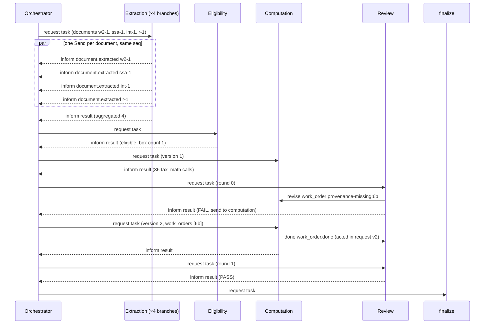

# Inter-agent communication

Code: `src/silverfile/comms/` (`protocol.py`, `contracts.py`, `bus.py`). Tests: `tests/test_comms.py`. Dashboard: the **Agent messages** card on each return, and `/returns/<id>/messages.json`.

## The problem

Before this layer, agents talked by writing loose fields into shared state: Review set `revise_target = "computation"` and a list of reason strings, Eligibility appended escalations, and the handoff log was a list of bare agent names. That works, but three things it could not do:

1. **Show who told whom what, and in answer to what.** A string in `handoffs` says Computation ran. It does not say why it ran (first pass, or a review finding) or what it reported back.
2. **Enforce the role constraints in the brief.** "Review must not fix things itself" and "only Intake talks to the taxpayer" were true because the code happened to be written that way. Nothing stopped a change to `review.py` from writing `lines`.
3. **Deliver more than one instruction at a time.** Review can find problems for both Extraction and Computation in one round, but `revise_target` holds a single name. The second agent never heard about its finding.

## Design

Shared graph state is still the transport, because LangGraph checkpoints it, which gives us resumability and HITL. On top of it sit a **message bus** (`mailbox`), a **channel policy**, and **write contracts**.

### 1. The envelope

Every exchange is an `AgentMessage` (`state.py`):

| Field | Meaning |
| --- | --- |
| `id` | Content-addressed hash of (seq, sender, recipient, performative, topic, in_reply_to, body). A redelivered message has the same id and is stored once. |
| `seq` | A logical clock. Each node posts at `max(seq) + 1`. The parallel extraction branches all post at the same seq. |
| `thread` | The correlation id. A request, its reply, and anything raised while handling it share a thread. |
| `in_reply_to` | The message this one answers. Replies (`inform`, `done`, `resolve`, `refuse`) must have one. |
| `sender`, `recipient` | One of the seven agents, `finalize`, `human` (a Kushim employee) or `taxpayer`. |
| `performative` | What kind of speech act it is (below). |
| `topic` + `body` | A typed payload. Each topic lists its required keys (`TOPICS`). |

Performatives are a small subset of FIPA-ACL:

| Performative | From → to | Used for |
| --- | --- | --- |
| `request` | orchestrator → worker | A handoff. The body carries the goal, the agent's read contract, and any open work orders for it. |
| `inform` | worker → orchestrator | The result, with a summary and the state keys it wrote. |
| `revise` | review → computation / extraction / eligibility / intake | A **work order**: one finding (check, severity, line, detail) for the agent that owns the fix. |
| `done` | worker → review | The work order was acted on. It replies to the `revise` and names the request it was handled in. |
| `escalate` | intake / eligibility / review / orchestrator → human | Mirrors an `Escalation` record. |
| `resolve` | human → orchestrator | A person resolved it. Replies to the `escalate`. |
| `refuse` | worker → orchestrator | Reserved for a worker that cannot act on a request. |
| `violation` | orchestrator → human | A contract breach, or a request that never got a reply. Kept for the audit. |
| `ask` / `answer` | intake ↔ taxpayer | One question turn. **Only the slot name is logged**, never the words. The words stay in the transcript. |

### 2. Channel policy

`protocol.CHANNELS` is a table of `(sender, performative) → allowed recipients`. `make_message` refuses anything not in the table with a `ProtocolError`. That puts the brief's rules into data, where a test can check them:

- Every `request` comes from the orchestrator and every `inform` goes to it. Workers never hand off to each other.
- Only Review can issue `revise`, and only to the four agents that can act on a finding.
- Only Intake can address the taxpayer.
- Only a `human` can `resolve`.

### 3. Write contracts

`contracts.WRITES` lists, for each agent, the state keys it may write. `READS` lists what it is given. The `communicating(agent, fn)` wrapper in `bus.py` applies the write contract to every node's update. A key outside the contract is dropped before it reaches state, and a `violation` message plus an event record the attempt. With `SILVERFILE_STRICT_CONTRACTS=1` the wrapper raises instead, for development. The rules that matter most:

- Review cannot write `lines` or `provenance`. It can only send work back.
- Only Computation populates `lines` and `provenance`; completing a human edit may clear those records to invalidate stale results, but cannot supply replacement figures. The deterministic `resolution_check` worker verifies staff continuation requests and records a yes/no outcome in `hitl_log`. Only Extraction writes `extracted`. Only Intake writes `messages` (the conversation).

Each orchestrator `request` lists the agent's read contract, so anyone reading the log can see what context the handoff carried. For example, Computation's request shows that it does not read the conversation.

### 4. The wrapper

Agent code stays a plain `state → update` function, and the protocol is added around it. After the agent returns, `communicating`:

1. enforces the write contract;
2. for Intake, posts an `ask`/`answer` pair for the slot;
3. closes every open work order for this agent with a `done` reply;
4. for Review, turns each high- or medium-severity finding with a fixable target into a `revise` work order on the thread `review-round-N`;
5. mirrors new escalations as `escalate`, and resolved ones as `resolve` replying to the original `escalate`;
6. replies `inform` to the orchestrator's pending `request`, on the same thread.

The orchestrator side is in `orchestrator._post`. Before every handoff it flags (once) any earlier request that never got a reply, posts `escalate` for the escalations it raises itself (`loop_guard`, `review_unresolved`), and then posts the `request` to the next agent.

## Sequence: a return where Review sends work back

This is the `drop_provenance_for: 6b` fault run (`test_review_work_order_round_trip`).

## Concurrency and the reducer

`mailbox` uses `merge_messages`. It dedupes by id and sorts by `(seq, id)`. The four extraction branches post at the same seq with content-addressed ids, so whichever branch finishes first, the merged log is identical. `test_bus_merge_is_order_independent_and_idempotent` merges the branch messages in all 24 orders and gets one result. It also shows that redelivering a message changes nothing. Because ids depend on content rather than wall-clock time or randomness, a node replayed from a checkpoint after an interrupt produces the same ids, so delivery is effectively exactly once.

## Message-driven routing

The orchestrator still decides with `decide_next`, and that function now reads the bus as well. If Review leaves work orders for more than one agent, `revise_target` routes to the first. After that agent finishes, any addressee whose orders are still open runs before Review sees the return again (`for agent in ("extraction", "eligibility", "computation"): if open_work_orders(...)`). The check sits after the review-pass, accept and review-bound rows, so a stale order cannot reopen an accepted return or get around `MAX_REVIEW_ROUNDS`.

Computation reads its work orders from the request and records each one in `computation_notes` ("re-run for review work order provenance-missing:6b: …"). That note appears on the draft form, so the preparer can see why a second version exists.

## Relation to the loop guard

The handoff-pattern loop guard (`detect_loop`) is unchanged and still owns cycle detection. The bus adds two complementary signals:

- a `loop_guard` stop appears on the bus as an `escalate` from the orchestrator, and its resolution as a `resolve`, so the stop and the human decision share a thread;
- a request with no reply is flagged as a `no_reply` violation, which catches a handoff that was silently dropped rather than one that repeated.

## PII on the bus

The bus is an audit trail that other agents and Kushim staff read, so `protocol.scrub` masks anything shaped like an SSN in every body to `***-**-1234` before the message is built. The `ask`/`answer` mirror carries only the slot name. The messages JSON endpoint masks again on the way out.

## Tests (`tests/test_comms.py`)

| Test | What it proves |
| --- | --- |
| `test_only_intake_may_address_the_taxpayer` | Policy: no other agent, with any performative, can reach the taxpayer |
| `test_workers_do_not_talk_to_each_other_except_by_work_order` | Hub-and-spoke is enforced: only the orchestrator hands off, and only Review issues work orders |
| `test_only_a_person_resolves_an_escalation` | No agent can resolve its own escalation |
| `test_malformed_messages_are_refused` | Schema: required body keys, known topic and sender, and replies need `in_reply_to` |
| `test_no_full_ssn_travels_on_the_bus` | Scrubbing, including nested values |
| `test_bus_merge_is_order_independent_and_idempotent` | The reducer under all 24 branch orders, plus redelivery |
| `test_review_cannot_write_lines` / `test_the_hub_drops_an_illegal_write_and_records_a_violation` | Write contract enforcement, in lenient and strict modes |
| `test_every_agent_stays_inside_its_contract_on_real_runs` | No violations on a clean run |
| `test_every_handoff_is_a_request_answered_on_its_thread` | Each request gets exactly one `inform`, on its thread, after it |
| `test_parallel_extraction_posts_one_result_per_document_at_the_same_time` | Fan-out messages share one seq; the aggregate replies after them |
| `test_requests_carry_the_read_contract` | Computation's handoff does not include the conversation |
| `test_review_work_order_round_trip` | revise → forwarded in the next request → done → noted on the draft |
| `test_open_work_orders_route_each_addressee_before_review_again` | Message-driven routing, and that a passed review is not reopened |
| `test_hitl_escalation_is_an_escalate_answered_by_a_resolve` | case 2 (spouse died): escalate and resolve on one thread |
| `test_loop_guard_escalation_is_posted_by_the_orchestrator` | The ping-pong fault on the bus |
| `test_an_unanswered_request_is_flagged_once` | Dropped-handoff detection without repeat flags |
| `test_intake_turns_are_logged_without_the_words` | A full scripted conversation: one ask/answer pair per turn, slot only |

## Trade-offs

- **Why not separate per-agent queues?** LangGraph checkpoints one state object per thread. A bus inside that state gets checkpointing, interrupts and resume for free. External queues would need their own persistence and would break the "abandoned Tuesday, resumed Friday" property.
- **Why not let agents call each other directly (`Command(goto=...)`)?** The brief puts the orchestrator in charge of who acts next and of termination. A worker that jumped straight to another worker would bypass the loop guard and the routing table. Peer-to-peer is limited to the revise/done pair, and even that is delivered by the hub, which forwards work orders inside its next `request`.
- **Cost.** A clean case 1 run posts about 14 messages. A full conversation adds two per intake turn. Bodies are summaries, not copies of state, so the checkpoint grows by a few KB per return.
